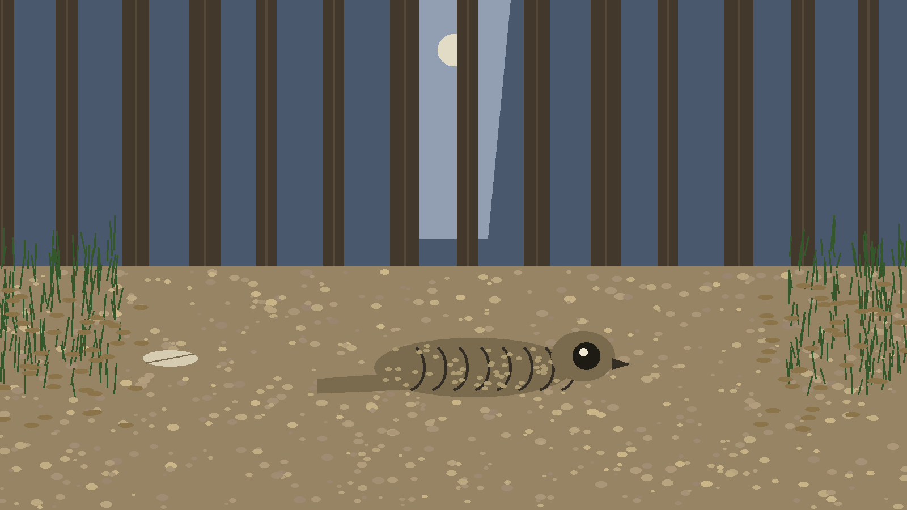
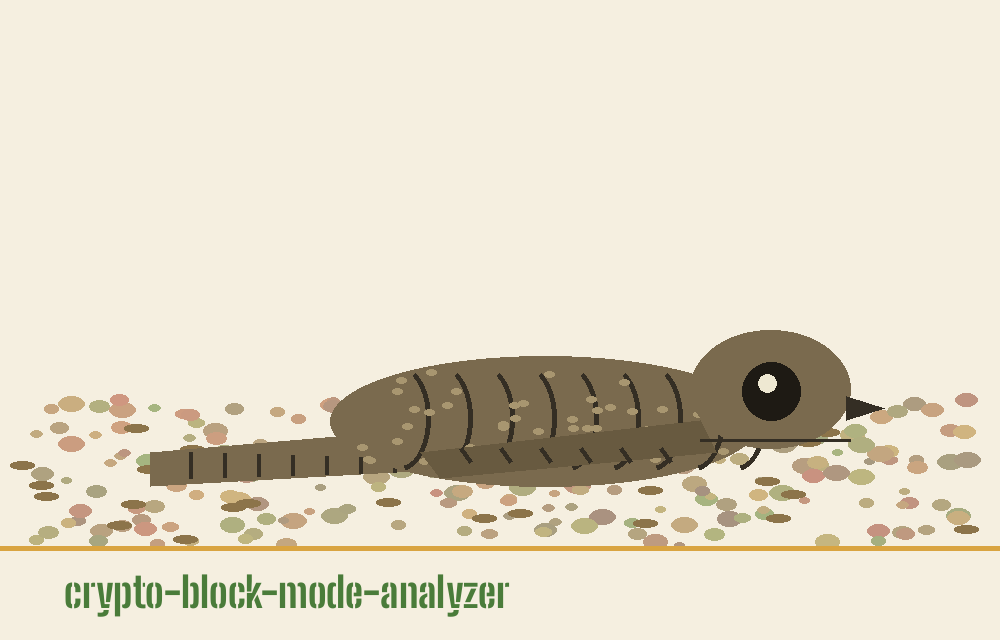
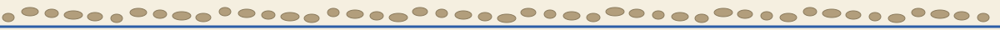
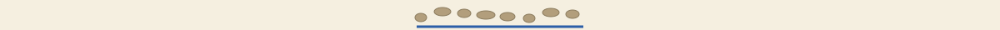

# crypto-block-mode-analyzer

Title block: a herbarium label. The name above is set in Big Shoulders Stencil in leaf green on cream, with a ruled line beneath and a small nightjar beside this first heading only. Later headings keep the label form alone.

# crypto-block-mode-analyzer

Analyzes ciphertext for the likely block cipher mode without requiring the key. It reports ECB when block repetition is found, reports CTR only from an optional statistical byte frequency test, and otherwise reports an undetermined outcome: CBC, CFB, and OFB cannot be told apart from each other on ciphertext alone. - Focused on Basic cryptographic operations

## Install

> Track notice: the input is one required file, ciphertext_file, holding hex text. Surrounding space is stripped and the hex is decoded to bytes. A missing file exits 1, bad hex exits 1, and other read faults exit 1.

`git clone https://github.com/ShadowStrikeHQ/crypto-block-mode-analyzer`

Flagged where it stands, and corrected nowhere in this README: the clone line above names a different organisation account altogether, the first of two occurrences of that name counted in the governing prose.

## Usage

> Track notice: the ECB verdict needs a ratio strictly above the threshold. At the default of 0.9, nine tenths exactly does not pass, because equal does not pass.

`./crypto-block-mode-analyzer [params]`

## Parameters

> Track notice: CTR sampling is unseeded. Two runs may draw differently and two runs may disagree, so one run is a hint and not a measurement.

- `-h`: Show help message and exit

- `--block_size`: No description provided

- `--threshold`: No description provided

- `--sample_size`: No description provided

- `--enable_ctr_test`: Enable statistical tests for CTR mode, which is time intensive.

## License

> Track notice: undetermined is a result. When neither test passes, CBC, CFB, and OFB cannot be told apart on ciphertext alone, and this tool does not pick one or rank them.

Copyright (c) ShadowStrikeHQ

Flagged where it stands: the licence line above carries the same other account name, the second of two occurrences. The separate LICENSE file carries the MIT License, and its holder line gives a pen name with a single initial for the remaining name.

## Facts from the code, stated in the prose

This record names: ciphertext_file, --block_size, 16, --threshold, 0.9, --sample_size, 1000, --enable_ctr_test, Likely mode: ECB, ECB not detected, Likely mode: CTR, CTR not detected, variance, 10, standard library only, exits 0, exits 1, python3 main.py.
